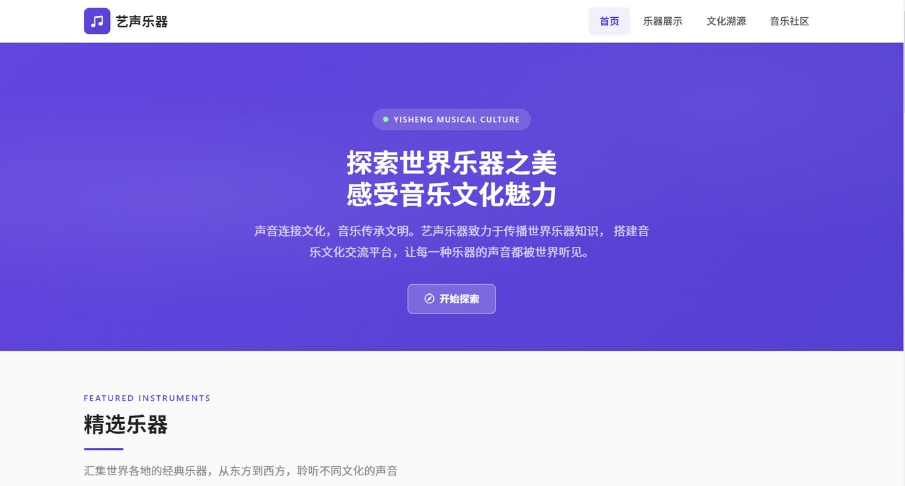

# 艺声乐器 · 世界乐器文化传播

> 声音连接文化，音乐传承文明。

**以紫色渐变与编辑式排版构建的乐器文化网站**  
毕业设计作品 · 使用 Claude Code 辅助开发

[](https://developer.mozilla.org/zh-CN/docs/Web/HTML)
[](https://developer.mozilla.org/zh-CN/docs/Web/CSS)
[](https://developer.mozilla.org/zh-CN/docs/Web/JavaScript)
[](https://getbootstrap.com/)
[](https://claude.com/claude-code)
[](#开发说明)

**[在线预览](https://morningluu.github.io/yisheng-music-website/)** · **[源码仓库](https://github.com/morningluu/yisheng-music-website)**



---

## 项目简介

「艺声乐器文化传播」是一个以**世界乐器文化传播**为主题的品牌网站。它不把乐器当作单纯的商品陈列，而是从“声音—文化—文明”的关系出发，展示古筝、西塔琴、钢琴、非洲鼓、萨克斯风、小提琴等乐器背后的地域与历史。

视觉上以紫色渐变为品牌主色，用大字号标题、编号卡片、细线网格与克制的留白建立现代编辑感；同时借助 Bootstrap 5 的栅格与组件能力，保证多页面在桌面和移动端的稳定排版。

## 页面与功能

| 页面 | 文件 | 主要内容 |
| --- | --- | --- |
| 首页 | `index.html` | 品牌主视觉、6 件精选乐器、文化溯源文章卡、社区入口、文化详情弹窗 |
| 乐器展示 | `instruments.html` | 名称 / 产地搜索、四类乐器筛选、重置、乐器卡片、分页 |
| 文化溯源 | `culture.html` | 中国、印度、西方等音乐文化长文、专题轮播、阅读导航 |
| 音乐社区 | `profile-comments.html` | 动态留言墙、社区统计、留言发布表单、字数计数与提示 |

### 核心交互

- **精选乐器**：六张乐器卡展示产地、价格、分类与浏览 / 收藏数据，支持进入详情。
- **搜索与筛选**：乐器页可按名称或产地检索，并按弦乐器、管乐器、打击乐器、键盘乐器筛选，可一键重置。
- **文化弹窗**：首页的“阅读全文”以模态层展示文化长文，避免频繁跳转。
- **动态留言墙**：社区页内置留言池，卡片以定时循环 + FLIP 动画平滑插入和移出，形成持续流动的社区氛围。
- **留言表单**：校验昵称与内容、限制 500 字、实时字数统计，提交后以 Toast 反馈并更新统计数字。
- **滚动体验**：导航滚动变色、当前栏目高亮、回到顶部按钮。
- **响应式**：6 组媒体查询 + Bootstrap 栅格，移动端折叠导航并重排卡片。

## 设计说明

- **品牌色**：`#5840D9` 紫色为主，搭配 `#6944E8` 渐变、浅紫背景与白色卡片。
- **字体**：Inter 用于英文与数字，系统中文字体承担正文，形成清晰的字重层级。
- **版式**：大标题 + 英文小标 + 细线分隔，借鉴音乐杂志与文化活动海报的编辑语言。
- **图形**：编号、胶囊标签、细线网格、圆形图标与渐隐光晕，强化“文化档案”的秩序感。
- **影像**：乐器特写统一裁切为横向比例，保证卡片节奏一致。
- **动效**：`shimmer`、`heartPop`、`toastIn` 与卡片悬浮，轻量而现代。

## 技术栈

- **HTML5**：四个内容页面，结构与组件保持一致。
- **CSS3**：设计变量、Bootstrap 栅格覆盖、Flexbox / Grid、渐变、媒体查询。
- **JavaScript**：搜索筛选、分页、模态框、动态留言墙、FLIP 动画、表单校验、Toast。
- **Bootstrap 5.3**：通过 CDN 引入栅格、导航、按钮与基础组件。
- **图标与字体**：Bootstrap Icons、Google Fonts（Inter），需要联网加载。

## 目录结构

```text
yisheng-music-website/
├── index.html
├── instruments.html
├── culture.html
├── profile-comments.html
├── css/
│   ├── style.css           # 品牌变量、基础版式与页面样式
│   ├── components.css      # 卡片、按钮、弹窗等组件
│   └── responsive.css      # 响应式断点
├── js/
│   ├── main.js             # 导航、弹窗、滚动等公共逻辑
│   ├── instruments.js      # 搜索、筛选、分页
│   └── profile.js          # 留言墙、表单与统计
├── images/                 # 乐器与文章配图
├── preview.jpg
└── README.md
```

## 本地运行

```bash
# 在项目根目录执行
python -m http.server 8000
```

访问 <http://localhost:8000>。页面通过 CDN 加载 Bootstrap、图标和 Inter 字体，首次打开需要网络连接。

## 开发说明

- **项目性质**：毕业设计 / 乐器文化传播品牌网站
- **开发方式**：使用 **Claude Code** 辅助完成页面结构、样式与交互实现，由作者完成内容组织、视觉方向与最终调整
- **设计关键词**：世界音乐、紫色渐变、编辑式排版、文化档案、动态社区
- **浏览器支持**：Chrome、Edge、Firefox、Safari 等现代浏览器

## 演示内容声明

页面中的品牌、乐器价格、浏览 / 收藏数据、联系方式与社区留言均为**毕业设计演示内容**，不构成真实交易或服务。图片、图标与字体仅用于学习与作品展示，版权归原作者所有；如有侵权请联系删除。

## 作者

[@morningluu](https://github.com/morningluu)
